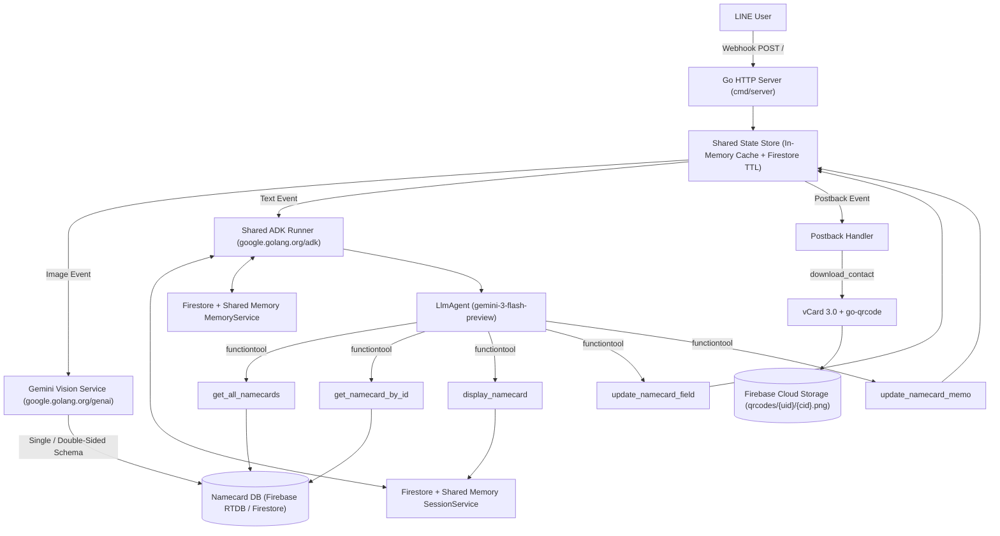

# LINE Bot Namecard Assistant (Go + ADK + Firestore) — Migration & Architecture Roadmap

## 1. 專案目標與架構升級重點

本專案將原本的 Python 版名片管理機器人（`kkdai/linebot-namecard-python`）完整遷移至 **Golang + Google Agent Development Kit (`google.golang.org/adk`)**，並針對生產環境進行以下核心升級：

1. **獨立 Go 專案架構 (`kkdai/linebot-namecard-go`)**：
   - 採用標準 Go 專案結構（`cmd/server`、`internal/...`），具備強型別安全、高併發與極致輕量的容器體積。
2. **共通記憶體與 Cloud Firestore 持久化 (`Firestore Session & Memory Service`)**：
   - 解決舊版 Python 每次請求都重新建立 `InMemorySessionService()` 導致無法跨對話記憶的問題。
   - 採用 **雙層共通記憶體架構（Shared In-Memory Cache + Cloud Firestore 持久化）**：
     - **ADK Session Service (`session.Service`)**：共用單例服務，將每個 `user_id` 的多輪對話歷史（Events）與狀態（Session State）同步寫入 Firestore (`adk_sessions/{session_id}`) 與記憶體快取。
     - **ADK Memory Service (`memory.Service`)**：支援跨 Session 的長期記憶檢索，儲存於 Firestore (`adk_memories/{user_id}/entries/{entry_id}`)。
     - **使用者互動狀態機 (`UserStateStore`)**：處理雙面名片等待背面圖 (`pending_backside_confirm` / `awaiting_backside_image`)、欄位編輯 (`editing_field` / `adding_memo`) 與 AI 修改二次確認 (`pending_update`)，具備共通記憶體快取與 Firestore 跨實例同步及 300 秒 TTL 自動過期清理機制。
3. **100% 功能對等移植**：
   - Gemini Vision 單面與正反雙面名片合併辨識（Structured JSON Schema 強制輸出）。
   - ADK `llmagent` + 5 個強型別 `functiontool`（查詢全部名片、查詢單筆名片、標記顯示名片、修改欄位、修改備忘錄）。
   - 多筆搜尋結果消歧義清單（$\le 4$ 張顯示 Giga Bubble Carousel，$> 4$ 張顯示清單 Flex Message）。
   - AI 修改資料前之「二次確認 Flex Message」安全沙盒。
   - Vertex AI / ADK 異常時之本地端關鍵字備援搜尋（Fallback Search）。
   - 電話 `tel:` 撥號、Email 點擊寄信／複製、LINE 原生分享連結（自動 UTF-8 百分比編碼與 1000 字元截斷）、vCard 3.0 QR Code 產生與 Cloud Storage 公開連結上傳。

---

## 2. 系統架構與資料流

---

## 3. Python 與 Go + ADK 模組對照表

| 功能模組 | 原 Python 檔案 | 新 Go 套件路徑 (`internal/...`) | 關鍵技術與升級點 |
| :--- | :--- | :--- | :--- |
| **環境設定** | `app/config.py` | `internal/config` | 支援 `PROJECT_ID`、`LOCATION` (`global`)、LINE 與 Firebase/Firestore 憑證載入 |
| **名片與 QR 儲存** | `app/firebase_utils.py` | `internal/storage` | 封裝名片 CRUD、Email 去重、統計資訊與 Cloud Storage QR Code 公開上傳 |
| **共通記憶體 & Firestore** | `bot_instance.py` (`user_states` + 臨時 `InMemorySessionService`) | `internal/memory` | 實作 ADK `session.Service`、`memory.Service` 與 `UserStateStore`，結合共通記憶體與 Firestore |
| **Gemini 影像 OCR** | `app/gemini_utils.py` | `internal/gemini` | 使用 `google.golang.org/genai` (`BackendVertexAI`) + `NAMECARD_SCHEMA` 單雙面名片解析 |
| **vCard & QR Code** | `app/qrcode_utils.py` | `internal/qrcode` | vCard 3.0 格式化、字元跳脫與 PNG QR Code 產生 |
| **Flex Messages** | `app/flex_messages.py` | `internal/flex` | 名片 Giga Bubble、編輯選單、消歧義清單、二次確認卡、`tel:` 與分享 URL 截斷 |
| **ADK Agent & Tools** | `app/line_handlers.py` (`make_adk_tools`, `handle_smart_query`) | `internal/agent` | 使用 `llmagent.New`、`functiontool.New`、`runner.New` 與本地端 Fallback 搜尋 |
| **LINE 事件處理** | `app/line_handlers.py` & `app/main.py` | `internal/bot` & `cmd/server` | 處理文字、圖片、Postback 事件與中斷狀態清理 |

---

## 4. 分階段實作計畫 (Step-by-Step Execution Plan)

### Step 1：專案骨架與設定管理 (`internal/config`, `internal/models`)
- [x] 建立 `kkdai/linebot-namecard-go` 儲存庫與 ` ROADMAP.md`。
- [x] 定義核心資料結構 `Namecard`、`Statistics`、`UserState` 與環境變數載入邏輯。
- [x] 支援預設與測試環境變數檢查，以及 `GOOGLE_APPLICATION_CREDENTIALS_JSON` 解析。

### Step 2：共通記憶體與 Firestore Session / State 服務 (`internal/memory`)
- [x] 實作 `UserStateStore`：提供雙層（Shared In-Memory `sync.RWMutex` + Cloud Firestore `user_states` collection）狀態讀寫、300 秒過期檢查 (`SweepExpiredStates`) 與安全刪除。
- [x] 實作 ADK `session.Service`（共通記憶體快取 + Firestore `adk_sessions` 持久化），讓 `Runner` 可跨對話保存上下文，同時支援在無雲端連線時自動退回純共通記憶體模式以利單元測試。
- [x] 實作 ADK `memory.Service`（共通記憶體快取 + Firestore `adk_memories` 持久化）。

### Step 3：名片資料庫與 Cloud Storage 服務 (`internal/storage`)
- [x] 實作名片儲存介面 `CardRepository`（同時支援 Firestore 與 Firebase Realtime Database，確保舊資料無痛相容、新資料可存 Firestore）。
- [x] 實作 `GetAllCards`、`GetCardByID`、`GetNameFromCard`、`AddNamecard`、`UpdateNamecardMemo`、`UpdateNamecardField`、`CheckIfCardExists`、`RemoveRedundantData`、`GetNamecardStatistics`。
- [x] 實作 Cloud Storage `UploadQRCodeToStorage`（上傳 `qrcodes/{user_id}/{card_id}.png` 並設為公開讀取）。

### Step 4：vCard QR Code 與 LINE Flex Message 建構器 (`internal/qrcode`, `internal/flex`)
- [x] 實作 `GenerateVCardString`、`GenerateVCardQRCode`、`GetQRCodeUsageInstruction`。
- [x] 實作 `ToTelURI`、`IsValidEmail`、`BuildShareText`、`BuildShareURL`（確保 UTF-8 URL 編碼後不超過 1000 字元）。
- [x] 實作 4 種 Flex Message：`GetNamecardFlexMsg`、`GetEditOptionsFlexMsg`、`GetNamecardListFlexMsg`（最多 8 筆）、`GetConfirmUpdateFlexMsg` 與 QuickReply 建構函式。
- [x] 撰寫完整單元測試驗證所有 URI、按鈕與字元截斷邏輯。

### Step 5：Gemini Vision 單／雙面名片結構化辨識 (`internal/gemini`)
- [x] 使用 `google.golang.org/genai` 設定 `gemini-3-flash-preview` 模型與 `NAMECARD_SCHEMA`。
- [x] 實作 `GenerateJSONFromImage`（單面）與 `GenerateJSONFromTwoImages`（正反雙面合併），附加 `labels: {"client_id": "namecard"}`。
- [x] 實作圖片格式正規化（支援將任意輸入圖片轉為標準 JPEG bytes）與 JSON 解析容錯處理。

### Step 6：ADK Go Agent、Function Tools 與 Webhook 處理器 (`internal/agent`, `internal/bot`, `cmd/server`)
- [x] 使用 `google.golang.org/adk` 建立 `namecard_agent` 與 5 個強型別 `functiontool`：
  - `get_all_namecards`
  - `get_namecard_by_id`
  - `display_namecard`
  - `update_namecard_memo`
  - `update_namecard_field`
- [x] 串接共通 `Runner` 與 Firestore Session Service，實作 `HandleSmartQuery` 與本地端關鍵字備援搜尋（Fallback Search）。
- [x] 實作完整 LINE 事件處理器：`HandleImageEvent`、`HandleTextEvent`、`HandlePostbackEvent` 與 FastAPI 對等的 HTTP 路由（`POST /`、`GET /`）。
- [x] 撰寫完整單元測試、Dockerfile 與 README 部署文件，並提交推送至 GitHub。
